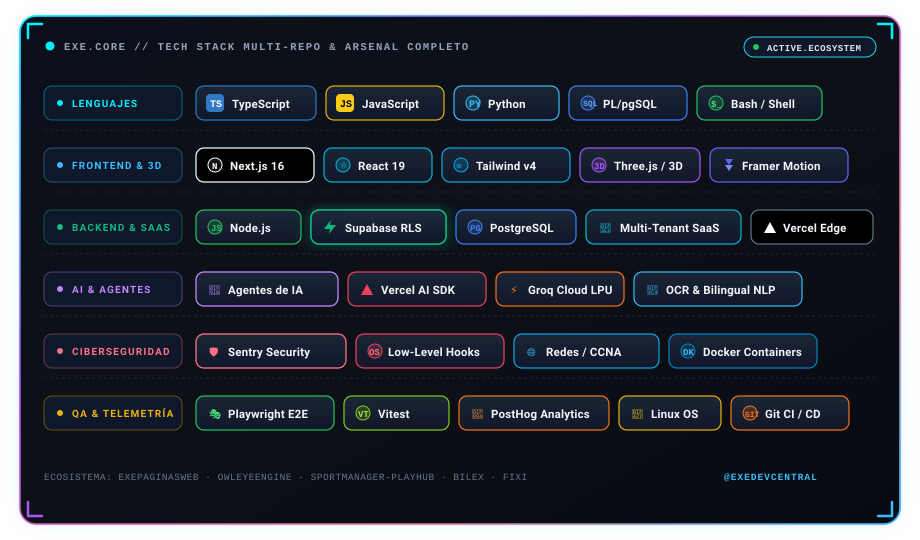

  

    

  
  
  
  

---

### 🏛️ Executive Value Proposition & Solutions Architecture

Full-Stack Solutions Engineer & Software Architect specializing in **fault-tolerant web architectures, high-throughput automation engines, and distributed systems**. I transform operational maturity and technical rigor into software that solves expensive business bottlenecks, cuts operational overhead, and delivers immediate ROI.

- 🏢 **Enterprise SaaS & Tailored Cloud Platforms:** End-to-end B2B infrastructure using **Next.js 16/React 19**, **TypeScript**, and **PostgreSQL** hardened with strict **Row Level Security (RLS)** and RBAC tenant isolation (e.g., [ExePaginasWeb](https://exepaginasweb.com), *SportManager PlayHub*, and *MultiTiendas*).
- ⚡ **High-Throughput Automation & AI Pipelines:** Low-level and batch processing engines in **C++** and **Python** (*OwlEyeEngine*), cutting manual data review workloads from **~5 hours to unattended minutes** with applied AI models.
- 📐 **Rigorous Formal Verification & CAS Engines:** Symbolic computation and axiomatic verification architectures (*Polymath Zero*) using **Astro 5**, **React 19**, strict TypeScript, and **KaTeX** math kernels.
- 📉 **Traceability & Error Eradication:** Production tracking pipelines that eliminated critical inventory discrepancies and **reduced reconciliation errors by 35%**.
- 🛡️ **Cyberdefense & Networking Observability:** Kernel-level systems monitoring, real-time audit journals, **Cisco-certified networking (CCNA Basics - Score 86/100, 2026)**, and heuristic threat detection.
- 🚀 **Sovereign Architectural Ownership:** Pure proprietary codebases across **+30 auditable GitHub repositories**, granting zero vendor lock-in and deterministic execution.

---

<h2 align="center">🛠️ Technical Arsenal & Core Systems Taxonomy</h2>

  

---

<h2 align="center">🚀 Flagship Architectural Works</h2>

| System | Domain | Architectural Invariants & Technical Specifications |
| :--- | :--- | :--- |
| [**OwlEyeEngine**](https://github.com/ExeDevCentral/OwlEyeEngine) | High-Performance Engine | C++ & Python batch automation pipeline with AI classification, reducing ~5 hours of manual work to minutes |
| [**Polymath-Zero**](https://github.com/ExeDevCentral/polymath-zero) | Formal Systems Workbench | Astro 5, React 19, KaTeX LaTeX rendering, simulated CAS REPL kernel (SymPy style), and reactive SVG vector plane |
| [**portalNoticias**](https://github.com/ExeDevCentral/portalNoticias) | Real-Time News Engine | Next.js 15 SSR, embedded SQLite WAL persistence, Server-Sent Events (SSE) live telemetry, 45 automated tests |
| [**Bilex**](https://github.com/ExeDevCentral/Bilex) | Bilingual Ingestion & OCR | WebAssembly Tesseract OCR pipeline, client n-gram Markov language identification, dual-stream AST scroll alignment |
| [**RESTOai**](https://github.com/ExeDevCentral/RESTOai) | Gastronomic POS Kernel | Zero-float 64-bit integer monetary arithmetic, FEFO inventory decay, blind "Z" reconciliation, 67 Vitest invariants |
| [**sportmanager-playhub**](https://github.com/ExeDevCentral/sportmanager-playhub) | Athletic Complex Engine | PostgreSQL `EXCLUDE USING gist` anti-double booking constraint, deterministic `mulberry32` dual-runtime simulation |
| [**ExePaginasWeb**](https://github.com/ExeDevCentral/ExePaginasweb) | Enterprise Cloud Studio | Hexagonal domain architecture, streaming AI SDK adapters, Svix HMAC-SHA256 verification, 183 automated tests |
| [**Chispa32**](https://github.com/ExeDevCentral/chispa32) | Industrial IoT Workbench | ESP32/ESP8266 embedded diagnostic workbench, Supabase RLS multi-tenant state machine, Telegram push webhooks |

---

<h2 align="center">📊 Live GitHub Telemetry & Stats</h2>

  
  

 

  

---

<h2 align="center">🐍 Continuous Contribution Trajectory</h2>

  <picture>
    <source media="(prefers-color-scheme: dark)" srcset="https://raw.githubusercontent.com/ExeDevCentral/ExeDevCentral/gh-pages/output/github-contribution-grid-snake-dark.svg" />
    <source media="(prefers-color-scheme: light)" srcset="https://raw.githubusercontent.com/ExeDevCentral/ExeDevCentral/gh-pages/output/github-contribution-grid-snake.svg" />
    
  </picture>

---

<h2 align="center">📬 Executive Inquiries & Systems Collaboration</h2>

  
  
  
  

  
    
  
  

    Engineered with mathematical precision and unwavering discipline by <strong>Exequiel Echevarría</strong>.
  

