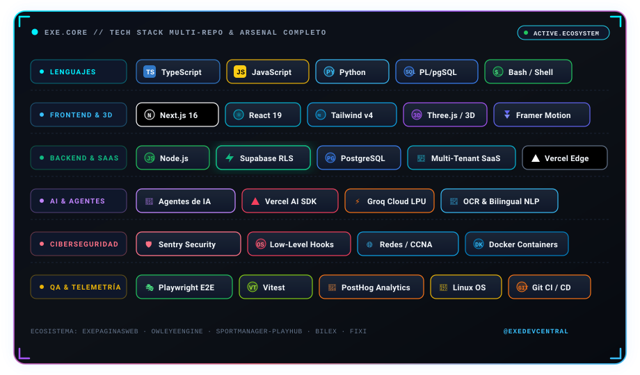

  

    

  
  
  
  

---

### 🏛️ Executive Value Proposition & Systems Architecture

Systems architect and software engineer specializing in **fault-tolerant web architectures, multi-tenant SaaS engines, and low-latency distributed telemetry**. I design, formalize, and deploy production software ecosystems that automate critical operational paths, eliminate structural throughput bottlenecks, and maximize transactional yield.

- 🏢 **Enterprise SaaS & Tailored Cloud Platforms:** End-to-end B2B infrastructure using **Next.js 16**, **TypeScript**, **React 19**, and **PostgreSQL** engines hardened with strict **Row Level Security (RLS)** tenant boundary isolation (e.g., [ExePaginasWeb](https://exepaginasweb.com) and *SportManager PlayHub*).
- ⚡ **Sub-Millisecond Latency & Core Web Vitals:** Deep optimization across edge networks and browser runtimes achieving sub-1.2s Largest Contentful Paint (LCP), zero Cumulative Layout Shift (CLS), and 60–120 FPS hardware-accelerated rendering.
- 🤖 **Autonomous AI Agents & Pipeline Orchestration:** Low-latency generative model routing via **Vercel AI SDK** and **Groq LPU clusters**, coupled with specialized document extraction (*Client-Side WebAssembly OCR & Trigram NLP* in *Bilex*).
- 🛡️ **Cyberdefense & Low-Level Observability:** Defensive kernel-level systems monitoring, real-time audit journals, Cisco-certified networking (CCNA), and automated heuristic threat detection (*OwlEyeEngine*).
- 🚀 **Sovereign Architectural Ownership:** Pure proprietary codebases granting zero-licensing lock-in, eliminating third-party platform rent extraction and proprietary dependency drift.

---

<h2 align="center">🛠️ Technical Arsenal & Core Systems Taxonomy</h2>

  

---

<h2 align="center">🚀 Flagship Architectural Works</h2>

| System | Domain | Architectural Invariants & Technical Specifications |
| :--- | :--- | :--- |
| [**portalNoticias**](https://github.com/ExeDevCentral/portalNoticias) | Real-Time News Engine | Next.js 15 SSR, embedded SQLite WAL persistence, Server-Sent Events (SSE) live telemetry, 45 automated tests |
| [**Bilex**](https://github.com/ExeDevCentral/Bilex) | Bilingual Ingestion & OCR | WebAssembly Tesseract OCR pipeline, client n-gram Markov language identification, dual-stream AST scroll alignment |
| [**RESTOai**](https://github.com/ExeDevCentral/RESTOai) | Gastronomic POS Kernel | Zero-float 64-bit integer monetary arithmetic, FEFO inventory decay, blind "Z" reconciliation, 67 Vitest invariants |
| [**sportmanager-playhub**](https://github.com/ExeDevCentral/sportmanager-playhub) | Athletic Complex Engine | PostgreSQL `EXCLUDE USING gist` anti-double booking constraint, deterministic `mulberry32` dual-runtime simulation |
| [**ExePaginasWeb**](https://github.com/ExeDevCentral/ExePaginasweb) | Enterprise Cloud Studio | Hexagonal domain architecture, streaming AI SDK adapters, Svix HMAC-SHA256 verification, 183 automated tests |
| [**Chispa32**](https://github.com/ExeDevCentral/chispa32) | Industrial IoT Workbench | ESP32/ESP8266 embedded diagnostic workbench, Supabase RLS multi-tenant state machine, Telegram push webhooks |

---

<h2 align="center">📊 Live GitHub Telemetry & Stats</h2>

  
  

 

  

---

<h2 align="center">🐍 Continuous Contribution Trajectory</h2>

  <picture>
    <source media="(prefers-color-scheme: dark)" srcset="https://raw.githubusercontent.com/ExeDevCentral/ExeDevCentral/gh-pages/output/github-contribution-grid-snake-dark.svg" />
    <source media="(prefers-color-scheme: light)" srcset="https://raw.githubusercontent.com/ExeDevCentral/ExeDevCentral/gh-pages/output/github-contribution-grid-snake.svg" />
    
  </picture>

---

<h2 align="center">📬 Executive Inquiries & Systems Collaboration</h2>

  
  
  
  

  
    
  
  

    Engineered with mathematical precision and unwavering discipline by <strong>Exequiel Echevarría</strong>.
  

